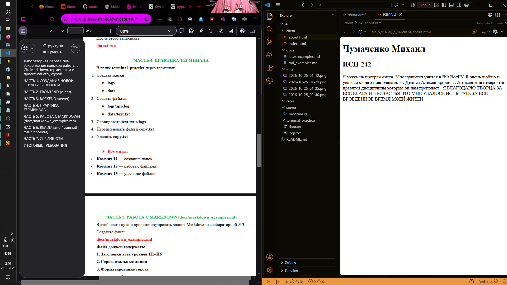
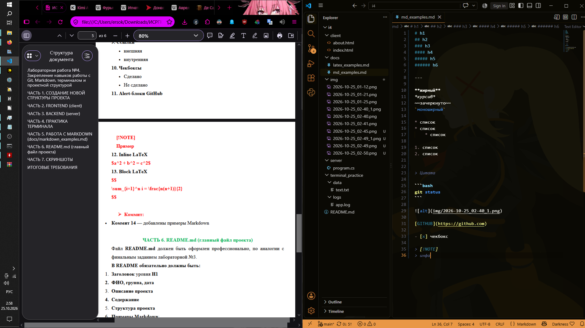
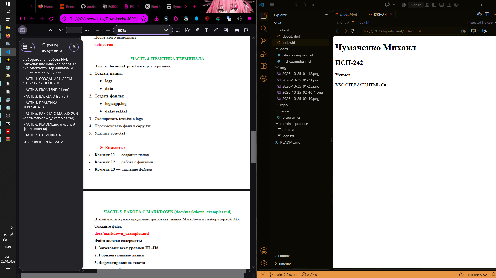

# ISRPO 4
* **Исполнитель:** Чумаченко Михаил 
* **Группа:** ИСП-242


---

## Содержание
1. [Описание проекта](#описание-проекта)
2. [Структура проекта](#структура-проекта)
3. [Примеры Markdown](#примеры-markdown)
4. [Примеры LaTeX](#примеры-latex)
5. [Скриншоты работы](#скриншоты-работы)
6. [Ссылка на репозиторий](#ссылка-на-репозиторий)
7. [Заключение](#заключение)

---

## Описание проекта
Данный проект представляет собой выполнение лабораторной работы №4 по дисциплине ИСРПО. Целью работы является практическое закрепление навыков создания структуры проекта через терминал, работы с системой контроля версий Git (фиксация частых коммитов), создания статических веб-страниц (Frontend), консольного приложения на платформе .NET (Backend), а также профессионального оформления документации с использованием синтаксиса Markdown и разметки LaTeX.

---

## Структура проекта
Ниже представлена итоговая древовидная структура каталогов и файлов репозитория, созданная в ходе выполнения работы через терминал:

```text
i4
├── client/
│   ├── about.html
│   └── index.html
├── docs/
│   ├── latex_examples.md
│   └── markdown_examples.md
├── img
├── server/
│   └── program.cs
├── terminal_practice/
│   ├── data/
│   │   └── text.txt
│   └── logs/
│       └── app.log
└── README.md
```

---

## Примеры Markdown

### Пример списка (коммиты первой части)
* Создание базовой структуры директорий.
* Инициализация Git-репозитория.
* Создание пустых файлов для Frontend и документации.

### Пример кода (проверка статуса Git)
```bash
git status
git log --oneline
```

### Пример встроенного изображения


---

## Примеры LaTeX

### Встроенная (inline) формула
Уравнение окружности в декартовой системе координат записывается как $a^2 + b^2 = c^2$.

### Блочная (block) формула
Вычисление суммы первых $n$ натуральных чисел:
$$
\sum_{i=1}^n i = \frac{n(n+1)}{2}
$$

---

## Скриншоты работы









---

## Заключение
В ходе выполнения лабораторной работы были успешно освоены базовые команды терминала для управления файловой структурой, отработан рабочий процесс Git и также настроено взаимодействие простейших клиентской и серверной частей приложения. Инструменты Markdown и LaTeX позволили структурировать и представить финальный отчет в профессиональном виде.
